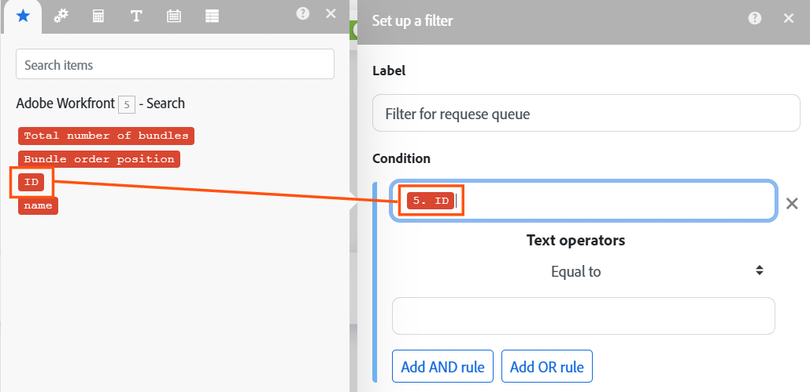
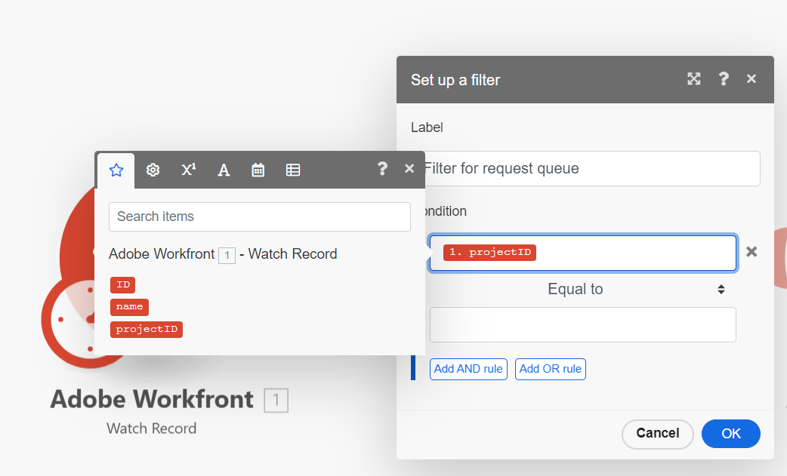

# Aggiungere un filtro a uno scenario di base

I filtri ti consentono di garantire che lo scenario avanzi solo se vengono soddisfatte determinate condizioni.

In questo esempio, aggiungi un filtro allo scenario che consente di creare un nuovo progetto a partire da una richiesta solo se la richiesta è stata inviata a una coda di richieste specifica.

In questo esempio viene modificato lo scenario creato in [Crea uno scenario di base](/help/workfront-fusion/build-practice-scenarios/create-basic-scenario.md).

>[!NOTE]
>
>* Workfront Fusion sta passando dall’editor dello scenario a una nuova esperienza. Durante questa transizione, sono disponibili sia le esperienze classiche che quelle nuove, e puoi passare da una all’altra in qualsiasi momento. È consigliabile utilizzare la nuova esperienza. Per ulteriori informazioni, consulta [Esperienze nuove e classiche](/help/workfront-fusion/get-started-with-fusion/navigate-fusion/scenario-editor.md#new-and-classic-experiences) nell&#39;articolo Editor scenari.
>* I moduli di attivazione di Workfront includono filtri che consentono l’avvio di uno scenario solo se vengono soddisfatte determinate condizioni. Tuttavia, poiché i filtri tra moduli vengono utilizzati per ogni caso di utilizzo non-trigger e non-Workfront, è importante imparare a utilizzare i filtri tra i moduli. In questo esempio viene utilizzato un filtro tra moduli per la funzionalità che potrebbe essere soddisfatta con un filtro interno al modulo.

## Requisiti di accesso

+++ Espandi per visualizzare i requisiti di accesso per la funzionalità descritta in questo articolo.

<table style="table-layout:auto">
 <col> 
 <col> 
 <tbody> 
  <tr> 
   <td role="rowheader">Pacchetto Adobe Workfront</td> 
   <td> 
Qualsiasi pacchetto Workflow di Adobe Workfront, e qualsiasi pacchetto Automation and Integration di Adobe Workfront.

Workfront Ultimate

Pacchetti Workfront Prime e Select, con un ulteriore acquisto di Workfront Fusion.
 </td> 
  </tr> 
  <tr data-mc-conditions=""> 
   <td role="rowheader">Licenze Adobe Workfront</td> 
   <td> 
Standard

Work o successiva
 </td> 
  </tr> 
  <tr> 
   <td role="rowheader">Prodotto</td> 
   <td>
   
Se la tua organizzazione dispone di un pacchetto Workfront Select o Prime che non include Workfront Automation and Integration, dovrà acquistare Adobe Workfront Fusion.</li></ul>
   </td> 
  </tr>
 </tbody> 
</table>

Per ulteriori dettagli sulle informazioni contenute in questa tabella, consulta [Requisiti di accesso nella documentazione](/help/workfront-fusion/references/licenses-and-roles/access-level-requirements-in-documentation.md).

+++

## Prerequisiti

È necessario creare lo scenario descritto in [Creare uno scenario di base](/help/workfront-fusion/build-practice-scenarios/create-basic-scenario.md) prima di seguire questa procedura.

## Aggiungi un filtro nella nuova esperienza (scelta consigliata)

* [Preparare l’aggiunta del filtro](#prepare-to-add-the-filter)
* [Aggiungere e configurare il filtro](#add-and-configure-the-filter)
* [Test e attivazione](#test-and-activate)

### Preparare l’aggiunta del filtro

1. Apri lo scenario.
1. Fai clic sul primo modulo per aprirlo.
1. Nell&#39;area **Output**, selezionare `Project`.
Ora dovresti avere `ID`, `Name` e `Project` selezionati.
1. Scegliere OK per salvare le impostazioni del modulo.
1. Apri Workfront.
1. In Workfront, individua il progetto che rappresenta la coda di richieste con cui lo scenario Fusion lavorerà.

   Il progetto deve trovarsi nello stesso account Workfront per il quale è impostata la connessione Fusion.

1. Prendi nota dell’ID progetto nell’URL.

   Esempio: https://\&lt;Dominio\>.my.workfront.com/project/\&lt;ID progetto\>/attività

### Aggiungere e configurare il filtro

1. Torna allo scenario nell’editor scenario.
1. Fare clic con il pulsante sinistro del mouse sul percorso tra il primo e il secondo modulo.

   Viene visualizzata la finestra **[!UICONTROL Configura filtro]**.

1. Nel campo Etichetta, immettere un&#39;etichetta per il filtro, ad esempio &quot;Filtra per coda richieste&quot;.
1. Nell&#39;area **Condizione**, nel campo superiore, mappare `projectID` dal primo modulo.

   

1. Lascia l&#39;operatore **Condition** uguale a.
1. Nel campo inferiore dell&#39;area **Condizione**, incolla l&#39;ID progetto di cui hai preso nota dall&#39;URL del progetto in [Prepara ad aggiungere il filtro](#prepare-to-add-the-filter).
1. Fare clic su **OK** per salvare le impostazioni del filtro.

### Test e attivazione

1. Vai all’ambiente Workfront a cui si connette Fusion e aggiungi un problema al progetto specificato nel filtro. Aggiungi un altro problema a un altro progetto.
1. Fai clic sull&#39;icona **[!UICONTROL Esegui una volta]**.

   Esegui una volta è solo un’icona nella nuova esperienza. Passa il puntatore sull&#39;icona per visualizzare la descrizione comando **[!UICONTROL Esegui una volta]**.

   

1. Esamina l’output per garantire che lo scenario sia stato eseguito come previsto.

   Entrambi i problemi dovrebbero comparire nell’output del primo modulo, ma solo il problema nel progetto specificato dovrebbe comparire come input nel secondo modulo.
1. Quando si è certi che lo scenario funziona come previsto, fare clic sull&#39;opzione **Pianificazione** per passare a **Il**.

   Questo attiva lo scenario.

   

1. Fai clic sull&#39;icona **Salva**  nell&#39;area Controlli per salvare l&#39;avanzamento dello scenario.

   >[!IMPORTANT]
   >
   >Risparmia spesso quando affili e testa uno scenario. Per attivare lo scenario, potrebbe essere necessario creare un nuovo problema nell’account Workfront.

## Aggiungere un filtro nell’esperienza classica

* [Preparare l’aggiunta del filtro (Classic)](#prepare-to-add-the-filter-classic)
* [Aggiungere e configurare il filtro (Classic)](#add-and-configure-the-filter-classic)
* [Test e attivazione (Classic)](#test-and-activate-classic)

### Preparare l’aggiunta del filtro (Classic)

1. Apri lo scenario.
1. Fai clic sul primo modulo per aprirlo.
1. Nell&#39;area **Output**, selezionare `Project`.
Ora dovresti avere `ID`, `Name` e `Project` selezionati.
1. Scegliere OK per salvare le impostazioni del modulo.
1. Apri Workfront.
1. In Workfront, individua il progetto che rappresenta la coda di richieste con cui lo scenario Fusion lavorerà.

   Il progetto deve trovarsi nello stesso account Workfront per il quale è impostata la connessione Fusion.

1. Prendi nota dell’ID progetto nell’URL.

   Esempio: https://\&lt;Dominio\>.my.workfront.com/project/\&lt;ID progetto\>/attività

### Aggiungere e configurare il filtro (Classic)

1. Torna allo scenario nell’editor scenario.
1. Fare clic sull&#39;icona chiave inglese  tra il primo e il secondo modulo e selezionare **Imposta filtro**.
1. Nel campo Etichetta, immettere un&#39;etichetta per il filtro, ad esempio &quot;Filtra per coda richieste&quot;.
1. Nell&#39;area **Condizione**, nel campo superiore, mappare `projectID` dal primo modulo.

   
1. Lascia l&#39;operatore **Condition** uguale a.
1. Nel campo inferiore dell&#39;area **Condizione**, incolla l&#39;ID progetto di cui hai preso nota dall&#39;URL del progetto in [Prepara ad aggiungere il filtro (Classic)](#prepare-to-add-the-filter-classic).
1. Fare clic su **OK** per salvare le impostazioni del filtro.

### Test e attivazione (Classic)

1. Vai all’ambiente Workfront a cui si connette Fusion e aggiungi un problema al progetto specificato nel filtro. Aggiungi un altro problema a un altro progetto.
1. Fai clic su **[!UICONTROL Esegui una volta]** nell&#39;angolo inferiore sinistro dell&#39;editor scenari.
1. Esamina l’output per garantire che lo scenario sia stato eseguito come previsto.

   Entrambi i problemi dovrebbero comparire nell’output del primo modulo, ma solo il problema nel progetto specificato dovrebbe comparire come input nel secondo modulo.
1. Quando si è certi che lo scenario funziona come previsto, fare clic sull&#39;interruttore **Pianificazione** in basso a sinistra dello schermo per **Attivato**.

   Questo attiva lo scenario.
1. In Workfront Fusion, fai clic su **[!UICONTROL Salva]** nell&#39;angolo inferiore sinistro per salvare l&#39;avanzamento dello scenario.

   >[!IMPORTANT]
   >
   >Risparmia spesso quando affili e testa uno scenario. Per attivare lo scenario, potrebbe essere necessario creare un nuovo problema nell’account Workfront.

## Risorse

* Per ulteriori informazioni sui filtri, vedere [Aggiungere un filtro a uno scenario](/help/workfront-fusion/create-scenarios/add-modules/add-a-filter-to-a-scenario.md).
