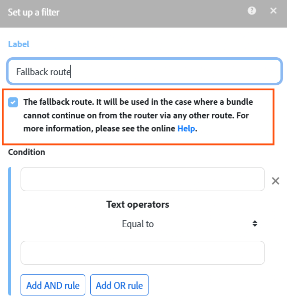

# Aggiungere un modulo router e configurare i percorsi

Il modulo Router consente di suddividere lo scenario in più route ed elaborare i dati all&#39;interno di ciascuna route in modo diverso. Quando un modulo Router riceve un bundle, lo inoltra a ogni route connessa nell&#39;ordine in cui le route sono state collegate al modulo Router.

Le route vengono elaborate in sequenza, non in parallelo. Un bundle viene inviato alla route successiva solo dopo che è stato completamente elaborato dalla route precedente.

>[!NOTE]
>
>Workfront Fusion sta passando dall’editor dello scenario a una nuova esperienza. Durante questa transizione, sono disponibili sia le esperienze classiche che quelle nuove, e puoi passare da una all’altra in qualsiasi momento. È consigliabile utilizzare la nuova esperienza. Per ulteriori informazioni, consulta [Esperienze nuove e classiche](/help/workfront-fusion/get-started-with-fusion/navigate-fusion/scenario-editor.md#new-and-classic-experiences) nell&#39;articolo Editor scenari.

## Requisiti di accesso

+++ Espandi per visualizzare i requisiti di accesso per la funzionalità descritta in questo articolo.

<table style="table-layout:auto">
 <col> 
 <col> 
 <tbody> 
  <tr> 
   <td role="rowheader">Pacchetto Adobe Workfront</td> 
   <td> 
Qualsiasi pacchetto Workflow di Adobe Workfront, e qualsiasi pacchetto Automation and Integration di Adobe Workfront.

Workfront Ultimate

Pacchetti Workfront Prime e Select, con un ulteriore acquisto di Workfront Fusion.
 </td> 
  </tr> 
  <tr data-mc-conditions=""> 
   <td role="rowheader">Licenze Adobe Workfront</td> 
   <td> 
Standard

Work o successiva
 </td> 
  </tr> 
  <tr> 
   <td role="rowheader">Prodotto</td> 
   <td>
   
Se la tua organizzazione dispone di un pacchetto Workfront Select o Prime che non include Workfront Automation and Integration, dovrà acquistare Adobe Workfront Fusion.</li></ul>
   </td> 
  </tr>
 </tbody> 
</table>

Per ulteriori dettagli sulle informazioni contenute in questa tabella, consulta [Requisiti di accesso nella documentazione](/help/workfront-fusion/references/licenses-and-roles/access-level-requirements-in-documentation.md).

+++

## Aggiungere un modulo router a uno scenario

È necessario aggiungere un modulo Router prima di configurare i percorsi.

* [Aggiungere un modulo router a uno scenario nella nuova esperienza (scelta consigliata)](#add-a-router-module-to-a-scenario-in-the-new-experience-recommended)
* [Aggiungere un modulo router a uno scenario nell’esperienza classica](#add-a-router-module-to-a-scenario-in-the-classic-experience)

### Aggiungere un modulo router a uno scenario nella nuova esperienza (scelta consigliata)

1. Fai clic sulla scheda **[!UICONTROL Scenari]** nel pannello a sinistra.
1. Selezionare lo scenario in cui aggiungere un router.
1. Fai clic in un punto qualsiasi dello scenario per accedere all’editor scenario.
1. Passa il puntatore del mouse sul bordo destro del modulo dopo il quale desideri aggiungere il router, quindi fai clic su **[!UICONTROL Aggiungi un altro modulo]** quando viene visualizzato. Nell&#39;elenco visualizzato selezionare la categoria **[!UICONTROL Incorporata]**, quindi selezionare **[!UICONTROL Controllo flusso]** > **[!UICONTROL Router]**.

   Oppure

   Per inserire il modulo Router tra due moduli, fare clic con il pulsante destro del mouse sul percorso che collega i due moduli, quindi selezionare **[!UICONTROL Aggiungi un router]**.

   

1. Aggiungere la prima route al router passando con il mouse sul bordo destro del router e aggiungendo un modulo, simile all&#39;aggiunta di qualsiasi modulo.
1. Per aggiungere un&#39;altra route, fare clic sul modulo router. Viene visualizzata una route. Aggiungere i moduli a questa route come desiderato.

   È possibile aggiungere tutte le route desiderate.

1. Per verificare l&#39;ordine delle route, controllare l&#39;etichetta di ciascuna route. La route 1 viene eseguita per prima, quindi la route 2 e così via.

   Oppure

   Fare clic sull&#39;icona **Allineamento automatico**  nell&#39;area Controlli.

   Le route sono disposte nell&#39;ordine in cui vengono eseguite. La route superiore viene eseguita per prima.

1. (Facoltativo) Per modificare l&#39;ordine di instradamento, fare clic con il pulsante destro del mouse sul modulo Router e selezionare **Instradamenti ordine**. Trascinare e rilasciare i percorsi nell&#39;ordine in cui si desidera eseguirli. Le route sono contrassegnate dal primo modulo che segue il router (il primo modulo della route).
1. (Facoltativo) Per disabilitare una route, fare clic con il pulsante destro del mouse sul percorso che conduce dal router a tale route e selezionare **Disabilita route**.

   Le route disattivate visualizzano punti grigi che conducono dal router al primo modulo della route e mostrano sull&#39;etichetta l&#39;icona della route disattivata .

1. (Facoltativo e condizionale) Per abilitare una route disabilitata, fare clic sull&#39;icona della route disabilitata  sull&#39;etichetta della route.
1. Continua con [Aggiungi un filtro a una route nella nuova esperienza](#add-a-filter-to-a-route-in-the-new-experience-recommended).

### Aggiungere un modulo router a uno scenario nell’esperienza classica

1. Fai clic sulla scheda **[!UICONTROL Scenari]** nel pannello a sinistra.
1. Selezionare lo scenario in cui aggiungere un router.
1. Fai clic in un punto qualsiasi dello scenario per accedere all’editor scenario.
1. Nell&#39;editor scenario fare clic sull&#39;handle destro del modulo dopo il quale si desidera aggiungere il router, quindi selezionare **[!UICONTROL Controllo flusso]** > **Router** nell&#39;elenco dei moduli visualizzati.

   

   Oppure

   Per inserire il modulo Router tra due moduli, fare clic sull&#39;icona chiave inglese sotto la route che collega i due moduli e selezionare **[!UICONTROL Aggiungi un router]** dal menu.

   
1. Aggiungere la prima route al router facendo clic sull&#39;handle destro del router e aggiungendo un modulo simile all&#39;aggiunta di qualsiasi modulo.
1. Per aggiungere un&#39;altra route, fare clic sul modulo router. Viene visualizzata una route. Aggiungere i moduli a questa route come desiderato.

   È possibile aggiungere tutte le route desiderate.

1. Per verificare l&#39;ordine delle route, controllare l&#39;etichetta di ciascuna route. La route 1 viene eseguita per prima, quindi la route 2 e così via.

   Oppure

   Fare clic sull&#39;icona Allineamento automatico .

   Le route sono disposte nell&#39;ordine in cui vengono eseguite. La route superiore viene eseguita per prima.

1. (Facoltativo) Per modificare l&#39;ordine di instradamento, fare clic con il pulsante destro del mouse sul modulo Router e selezionare **Ordina instradamenti** Trascinare e rilasciare i instradamenti nell&#39;ordine in cui si desidera che vengano eseguiti. Le route sono contrassegnate dal primo modulo che segue il router (il primo modulo della route).

   

1. (Facoltativo) Per disabilitare una route, fare clic con il pulsante destro del mouse sui punti che conducono dal router a tale route e selezionare **Disabilita route**.

   Le route disattivate visualizzano punti grigi che conducono dal router al primo modulo della route e mostrano sull&#39;etichetta l&#39;icona della route disattivata .

1. (Facoltativo e condizionale) Per abilitare una route disabilitata, fare clic sull&#39;icona della route disabilitata  sull&#39;etichetta della route.
1. Continua con [Aggiungi un filtro a una route nell&#39;esperienza classica](#add-a-filter-to-a-route-in-the-classic-experience).

## Aggiungere un filtro a un ciclo di lavorazione

Puoi inserire un filtro su un percorso dopo il modulo Router per filtrare i bundle. Solo i bundle che passano attraverso il filtro verranno gestiti dai moduli sulla route.

Se i dati passano il filtro di più route, i dati vengono gestiti da entrambe le route. La route superiore gestisce prima i dati.

I router con filtri visualizzano l&#39;icona del filtro  sull&#39;etichetta della route.

* [Aggiungere un filtro a un percorso nella nuova esperienza (scelta consigliata)](#add-a-filter-to-a-route-in-the-new-experience-recommended)
* [Aggiungere un filtro a un percorso nell’esperienza classica](#add-a-filter-to-a-route-in-the-classic-experience)

### Aggiungere un filtro a un percorso nella nuova esperienza (scelta consigliata)

1. Fai clic sulla scheda **[!UICONTROL Scenari]** nel pannello a sinistra.
1. Seleziona lo scenario in cui desideri aggiungere un filtro.
1. Fai clic in un punto qualsiasi dello scenario per accedere all’editor scenario.
1. Fare clic con il pulsante sinistro del mouse sul percorso in cui si desidera impostare un filtro. Percorso tra il modulo router e il primo modulo della route.

   La finestra **[!UICONTROL Configura filtro]** si apre direttamente.

1. Nel campo etichetta del pannello visualizzato, aggiungi un’etichetta. Questa etichetta viene visualizzata nello scenario.
1. Configurare le condizioni del filtro.

   Per ulteriori informazioni, consulta [Aggiungere un filtro a uno scenario](/help/workfront-fusion/create-scenarios/add-modules/add-a-filter-to-a-scenario.md).

   

1. Fare clic su **[!UICONTROL OK]** per salvare la configurazione del filtro.
1. (Condizionale) Se il nome del filtro è troppo lungo per poter essere inserito nell’etichetta, passa il puntatore del mouse sull’etichetta per visualizzare l’intero nome.

1. Continua con [Configurare una route di fallback nella nuova esperienza](#configure-a-fallback-route-in-the-new-experience-recommended).

### Aggiungere un filtro a un percorso nell’esperienza classica

1. Fai clic sulla scheda **[!UICONTROL Scenari]** nel pannello a sinistra.
1. Seleziona lo scenario in cui desideri aggiungere un filtro.
1. Fai clic in un punto qualsiasi dello scenario per accedere all’editor scenario.
1. Fare clic sull&#39;icona chiave inglese  nel percorso in cui si desidera impostare un filtro. Percorso tra il modulo router e il primo modulo della route.
1. Seleziona **Configura un filtro.**
1. Nel campo etichetta del pannello visualizzato, aggiungi un’etichetta. Questa etichetta viene visualizzata nello scenario.
1. Configurare le condizioni del filtro.

   Per ulteriori informazioni, consulta [Aggiungere un filtro a uno scenario](/help/workfront-fusion/create-scenarios/add-modules/add-a-filter-to-a-scenario.md).

1. Fare clic su **[!UICONTROL OK]** per salvare la configurazione del filtro.
1. (Condizionale) Se il nome del filtro è troppo lungo per poter essere inserito nell’etichetta, passa il puntatore del mouse sull’etichetta per visualizzare l’intero nome.

1. Continua con [Configurare una route di fallback nell&#39;esperienza classica](#configure-a-fallback-route-in-the-classic-experience).

## Configurare una route di fallback

La route di fallback è la route che viene eseguita su tutti i bundle che non passano alcun filtro a un&#39;altra route.

I percorsi di fallback visualizzano &quot;Fallback&quot; sull’etichetta.

Puoi abilitare una route di fallback nel pannello dei filtri.

* [Configurare una route di fallback nella nuova esperienza (scelta consigliata)](#configure-a-fallback-route-in-the-new-experience-recommended)
* [Configurare una route di fallback nell’esperienza classica](#configure-a-fallback-route-in-the-classic-experience)

### Configurare una route di fallback nella nuova esperienza (scelta consigliata)

1. Fai clic sulla scheda **[!UICONTROL Scenari]** nel pannello a sinistra.
1. Selezionare lo scenario in cui si desidera aggiungere una route di fallback.
1. Fai clic in un punto qualsiasi dello scenario per accedere all’editor scenario.
1. Fare clic con il pulsante sinistro del mouse sul percorso in cui si desidera impostare un filtro. Percorso tra il modulo router e il primo modulo della route.

   La finestra **[!UICONTROL Configura filtro]** si apre direttamente.

1. Nel campo etichetta del pannello visualizzato, aggiungi un’etichetta. Questa etichetta viene visualizzata nello scenario.
1. Abilitare la casella di controllo della route di fallback.

   

1. Fare clic su **[!UICONTROL OK]** per salvare la configurazione del filtro.

L&#39;etichetta della route di fallback visualizza **Fallback** in verde.

### Configurare una route di fallback nell’esperienza classica

1. Fai clic sulla scheda **[!UICONTROL Scenari]** nel pannello a sinistra.
1. Selezionare lo scenario in cui si desidera aggiungere una route di fallback.
1. Fai clic in un punto qualsiasi dello scenario per accedere all’editor scenario.
1. Fare clic sull&#39;icona chiave inglese  nel percorso in cui si desidera impostare un filtro. Percorso tra il modulo router e il primo modulo della route.
1. Seleziona **Configura un filtro.**
1. Nel campo etichetta del pannello visualizzato, aggiungi un’etichetta. Questa etichetta viene visualizzata nello scenario.
1. Abilitare la casella di controllo della route di fallback.

   

1. Fare clic su **[!UICONTROL OK]** per salvare la configurazione del filtro.

La route di fallback è contrassegnata da una freccia diversa nel modulo Router:

## Piegare un router

>[!NOTE]
>
>Questa funzione è disponibile solo nella nuova esperienza dell’editor di scenari.

Nella nuova esperienza, è possibile chiudere un router per nasconderne temporaneamente le route. Questo è utile in scenari di grandi dimensioni.

1. Apri lo scenario nell’editor scenario, in modalità di modifica.
1. Fai clic con il pulsante destro del mouse sul router che desideri piegare, quindi seleziona **Piega route**

Il router piegato mostra il numero di route e moduli nascosti, inclusa la gravità di eventuali avvisi o errori nascosti.

Piegando un router non si rimuove o si disattiva nulla. La cronologia di ricerca, convalida, Live Trail ed esecuzione espande automaticamente un router piegato quando deve mostrare un modulo al suo interno.

Lo stato piegato viene salvato con lo scenario e funziona con Annulla e Ripristina. Quando rivedi l’esecuzione di uno scenario, viene sempre visualizzato lo scenario completo.

## Esempio: `if/else` caso d&#39;uso

>[!BEGINSHADEBOX]

Un caso d’uso tipico della route di fallback consiste nel continuare il flusso con una route se la condizione è soddisfatta e con un’altra route se non lo è. come nei seguenti passaggi:

In questo esempio, la prima route è configurata con un filtro. Rappresenta il componente `if`.

La seconda route è configurata come route di fallback. Rappresenta il componente `else`.

>[!ENDSHADEBOX]
