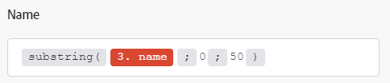
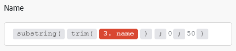
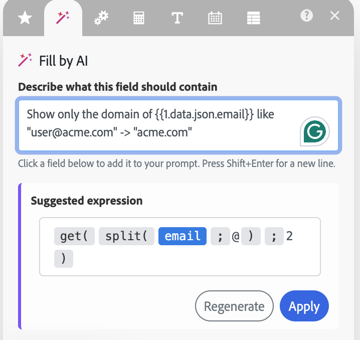
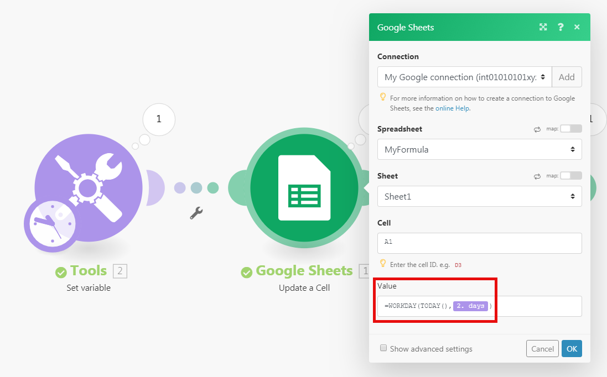
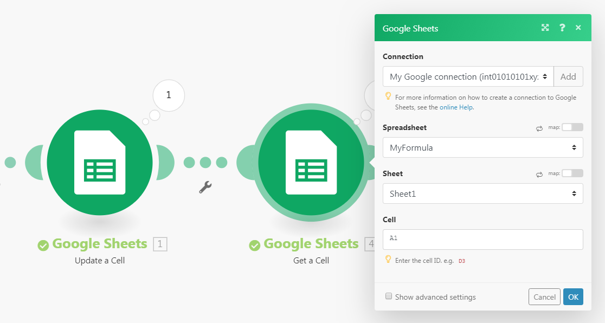

# Mappare un elemento utilizzando le funzioni incorporate

Workfront Fusion include funzioni incorporate che consentono di creare formule semplici o complesse. Queste funzioni coprono un&#39;ampia varietà di casi d&#39;uso, tra cui funzioni per array, stringhe, numeri e dati dei moduli precedenti.

Inoltre, puoi creare funzioni e pacchetti personalizzati da utilizzare negli scenari per trasformare e manipolare i dati.

Per informazioni e istruzioni sulle funzioni personalizzate, vedere [Mappare i dati utilizzando le funzioni personalizzate](/help/workfront-fusion/create-scenarios/map-data/map-using-custom-functions.md).

Per informazioni e istruzioni sui pacchetti di funzioni, vedere [Utilizzare pacchetti di funzioni personalizzati](/help/workfront-fusion/create-scenarios/map-data/use-custom-function-packages.md).

## Requisiti di accesso

+++ Espandi per visualizzare i requisiti di accesso per la funzionalità descritta in questo articolo.

<table style="table-layout:auto">
 <col> 
 <col> 
 <tbody> 
  <tr> 
   <td role="rowheader">Pacchetto Adobe Workfront</td> 
   <td> 
Qualsiasi pacchetto Workflow di Adobe Workfront, e qualsiasi pacchetto Automation and Integration di Adobe Workfront.

Workfront Ultimate

Pacchetti Workfront Prime e Select, con un ulteriore acquisto di Workfront Fusion.
 </td> 
  </tr> 
  <tr data-mc-conditions=""> 
   <td role="rowheader">Licenze Adobe Workfront</td> 
   <td> 
Standard

Work o successiva
 </td> 
  </tr> 
  <tr> 
   <td role="rowheader">Prodotto</td> 
   <td>
   
<ul><li>Se la tua organizzazione dispone di un pacchetto Workfront Select o Prime che non include Workfront Automation and Integration, dovrà acquistare Adobe Workfront Fusion.</li><li>Per utilizzare le funzioni personalizzate è necessario disporre di una licenza Adobe App Builder.</ul>
   </td> 
  </tr>
 </tbody> 
</table>

Per ulteriori dettagli sulle informazioni contenute in questa tabella, consulta [Requisiti di accesso nella documentazione](/help/workfront-fusion/references/licenses-and-roles/access-level-requirements-in-documentation.md).

+++

## Mappare i dati utilizzando le funzioni integrate

Durante la mappatura degli elementi, puoi utilizzare funzioni per la creazione di formule semplici o complesse. Le funzioni disponibili sono simili a quelle presenti in Excel e in alcuni linguaggi di programmazione:

* Queste valutano la logica generale, la matematica, il testo, le date e gli array.
* Consentono di eseguire logica condizionale e trasformazioni dei valori degli elementi, ad esempio la conversione di un testo in maiuscolo, il ritaglio del testo, la conversione di una data in un formato diverso e altro ancora.

### Inserisci funzioni nei campi

Per inserire una funzione in un campo:

1. Fai clic sulla scheda **[!UICONTROL Scenari]** nel pannello a sinistra.
1. Seleziona lo scenario in cui desideri mappare i dati.
1. Fai clic in un punto qualsiasi dello scenario per accedere all’editor scenario.
1. Fare clic sul campo in cui si desidera inserire una funzione.
1. Selezionare la scheda nel pannello di mappatura contenente la funzione che si desidera inserire.

   Per informazioni sulle schede del pannello di mappatura, vedi [Panoramica delle funzioni](/help/workfront-fusion/get-started-with-fusion/understand-fusion/function-overview.md)
1. Fare clic sul nome della funzione.

   Oppure

   Trascina la funzione nel campo.
1. Configura i parametri della funzione.

   Per una spiegazione dei parametri di funzione, passa il cursore sulla funzione nel pannello di mappatura.

   Per ulteriori informazioni sulle funzioni e i relativi parametri, vedere gli articoli in [Riferimenti alle funzioni: article index](/help/workfront-fusion/references/mapping-panel/functions/functions-toc.md).

1. Continuare la configurazione del modulo oppure fare clic su **OK**.

>[!TIP]
>
>Quando si crea una formula complessa che si desidera riutilizzare in un altro campo, è possibile fare clic sul campo che contiene la combinazione, utilizzare Cmd-A o Ctrl-A per selezionarla, quindi copiarla e incollarla nell&#39;altro campo.

>[!BEGINSHADEBOX]

**Esempio:** alcuni tipi di dati impediscono agli utenti di immettere più di un determinato numero di caratteri. Puoi utilizzare la funzione di sottostringa per limitare un valore a un determinato numero di caratteri.

In questo esempio, la funzione di sottostringa limita il nome del progetto a 50 caratteri.

>[!ENDSHADEBOX]

### Nidificazione delle funzioni

È possibile nidificare le funzioni l&#39;una nell&#39;altra.

>[!BEGINSHADEBOX]

**Esempio:**

In questo esempio, la funzione di sottostringa limita il nome del progetto tagliato a 50 caratteri.

>[!ENDSHADEBOX]

Per nidificare una funzione:

1. Fare clic sul campo in cui si sta creando una formula.

   Viene aperto il pannello di mappatura.

1. Fare clic sulla prima funzione che si desidera aggiungere. Questa è la funzione all&#39;esterno. Nell&#39;esempio seguente, questa è la funzione `substring`.
1. In tale funzione, fare clic nel punto in cui si desidera spostare la funzione nidificata. In questo esempio, la funzione nidificata sostituisce il primo parametro.
1. Nel pannello di mappatura, fai clic sulla funzione nidificata. In questo esempio, questa è la funzione `trim`.
1. Continuare a configurare la funzione come desiderato.
1. Continuare la configurazione del modulo oppure fare clic su **OK**.

### Generare un’espressione con IA

Invece di scrivere autonomamente la sintassi di un’espressione, puoi descrivere ciò che desideri in linguaggio semplice e AI genera l’espressione al posto tuo. Ad esempio, puoi richiedere quanto segue:

* Unisci questi nomi con una virgola.
* Aggiungi tre giorni alla data di scadenza.

AI trasforma la richiesta in un’espressione che utilizza le funzioni integrate di Workfront Fusion, in modo che il risultato sia leggibile e facile da rivedere prima di utilizzarla.

Per generare un&#39;espressione:

1. Fai clic sulla scheda **[!UICONTROL Scenari]** nel pannello a sinistra.
1. Seleziona lo scenario in cui desideri mappare i dati.
1. Fai clic in un punto qualsiasi dello scenario per accedere all’editor scenario.
1. Fai clic sul modulo in cui desideri aggiungere un’espressione, quindi fai clic sul campo.

   Viene visualizzato il pannello di mappatura.

1. Fai clic sulla scheda **[!UICONTROL Riempi per IA]** (icona a forma di bacchetta magica) nel pannello di mappatura.

   

1. Nella casella **[!UICONTROL Descrivi il contenuto del campo]**, descrivi il risultato desiderato in linguaggio semplice.

   Per aggiungere alla richiesta un campo di un modulo precedente, fare clic su di esso nell&#39;elenco **[!UICONTROL Campi disponibili]**. Per iniziare una nuova riga nel prompt, premere MAIUSC+INVIO.

   Ad esempio, per ottenere solo il dominio da un indirizzo e-mail, puoi immettere il seguente prompt:

   `Show only the domain of {{1.data.json.email}} like "user@acme.com" -> "acme.com"`

1. Fai clic su **[!UICONTROL Genera]**.

   L&#39;espressione generata da IA viene visualizzata in **[!UICONTROL Espressione suggerita]**.

   

1. Rivedi l’espressione, quindi effettua una delle seguenti operazioni:

   * Fai clic su **[!UICONTROL Applica]** per inserire l&#39;espressione nel campo.
   * Fare clic su **[!UICONTROL Rigenera]** per fare in modo che AI generi un&#39;espressione diversa.

1. (Facoltativo) Se necessario, modifica l’espressione nel campo.

1. Continuare la configurazione del modulo oppure fare clic su **[!UICONTROL OK]**.

#### Generazione di espressioni da parte di IA

Quando IA genera un’espressione, esegue le seguenti operazioni:

* **Utilizza il contesto dello scenario.** IA considera i campi disponibili per la mappatura, i relativi tipi, il campo di destinazione e le impostazioni internazionali e del fuso orario.
* **Convalida l&#39;espressione.** Prima che IA restituisca un’espressione come riuscita, verifica la presenza di funzioni non supportate, argomenti mancanti, riferimenti a campi sconosciuti ed errori comuni con matrici e date.
* **Corregge e semplifica l&#39;espressione.** L’intelligenza artificiale corregge gli errori di sintassi più comuni e sostituisce le soluzioni alternative riconosciute con funzioni incorporate.
* **Riprova se la convalida non riesce.** IA utilizza il feedback specifico della convalida per rigenerare l’espressione. Se non è comunque possibile creare un&#39;espressione valida, restituisce un errore di cancellazione anziché un risultato non valido.

>[!NOTE]
>
>Le espressioni generate dall’intelligenza artificiale possono essere incomplete o imprecise. Rivedi ogni espressione e verifica lo scenario prima di affidarti al risultato.

### Utilizza le funzioni [!DNL Google Sheets]

Se Workfront Fusion non include una funzione che si desidera utilizzare, ma è disponibile in [!DNL Google Sheets], è possibile utilizzarla seguendo la procedura seguente:

1. In [!DNL Google Sheets] creare un nuovo foglio di calcolo vuoto.
1. Apri lo scenario in Workfront Fusion.
1. Aggiungi il modulo **[!DNL Google Sheets]** >**[!UICONTROL Aggiorna cella]** allo scenario.

1. Configura il modulo:

   1. Scegliere il nuovo foglio di calcolo creato nel campo **[!UICONTROL Foglio di calcolo]**.
   1. Inserire la formula contenente le funzioni [!DNL Google Sheets] nel campo **[!UICONTROL Valore]**.

      Puoi utilizzare come di consueto l’output dei moduli precedenti.

      

1. Inserire il modulo **[!UICONTROL Fogli Google] >[!UICONTROL Ottieni una cella]** per ottenere il risultato calcolato.
1. Configura il modulo utilizzando lo stesso ID cella utilizzato nel passaggio 4.

   

