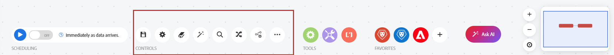
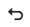
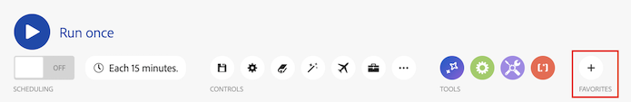

# Editor scenario

L’editor degli scenari consente di creare e modificare scenari in un’interfaccia visiva.

La nuova esperienza dell’editor di scenari:

Esperienza dell’editor di scenario classico

## Requisiti di accesso

+++ Espandi per visualizzare i requisiti di accesso per la funzionalità descritta in questo articolo.

<table style="table-layout:auto">
 <col> 
 <col> 
 <tbody> 
  <tr> 
   <td role="rowheader">Pacchetto Adobe Workfront</td> 
   <td> 
Qualsiasi pacchetto Workflow di Adobe Workfront, e qualsiasi pacchetto Automation and Integration di Adobe Workfront.

Workfront Ultimate

Pacchetti Workfront Prime e Select, con un ulteriore acquisto di Workfront Fusion.
 </td> 
  </tr> 
  <tr data-mc-conditions=""> 
   <td role="rowheader">Licenze Adobe Workfront</td> 
   <td> 
Standard

Work o successiva
 </td> 
  </tr> 
  <tr> 
   <td role="rowheader">Prodotto</td> 
   <td>
   
Se la tua organizzazione dispone di un pacchetto Workfront Select o Prime che non include Workfront Automation and Integration, dovrà acquistare Adobe Workfront Fusion.</li></ul>
   </td> 
  </tr>
 </tbody> 
</table>

Per ulteriori dettagli sulle informazioni contenute in questa tabella, consulta [Requisiti di accesso nella documentazione](/help/workfront-fusion/references/licenses-and-roles/access-level-requirements-in-documentation.md).

+++

## Esperienze nuove e classiche

Workfront Fusion sta passando dall’editor dello scenario a una nuova esperienza. Durante questa transizione, sono disponibili sia le esperienze classiche che quelle nuove, e puoi passare da una all’altra in qualsiasi momento. È consigliabile utilizzare la nuova esperienza.

La nuova esperienza include:

* Area di lavoro riprogettata, con moduli in stile scheda, controlli di riduzione a icona e zoom.
* Nuovi controlli dell&#39;editor scenario, tra cui Trova e sostituisci, Snippet e Annulla/Ripristina.
* Un pulsante Chiedi AI.
* Selettore di connettori aggiornato con navigazione per categorie e la possibilità di contrassegnare i preferiti in linea.
* Una modalità scura che segue l&#39;impostazione dell&#39;aspetto.
* Possibilità di piegare un router per nasconderne le route.
* [Live Trail](/help/workfront-fusion/manage-scenarios/live-trail.md), un pannello che mostra uno scenario eseguito mentre si verifica.
* Diversi Strumenti per sviluppatori ora incorporati nell’editor di scenari.
* Registri di debug temporanei, che puoi attivare nelle impostazioni dello scenario.

Per passare dall’esperienza classica a quella nuova:

1. Nell&#39;editor dello scenario, individua **[!UICONTROL Prova la nuova struttura]** nell&#39;angolo superiore destro.
1. Fai clic sull’interruttore per passare alla nuova esperienza.
1. Per tornare all’esperienza classica, fai di nuovo clic sull’interruttore.

Lo scenario si ricarica quando si passa da un momento all’altro. La scelta viene salvata per l’utente, quindi non modifica l’esperienza visualizzata dai tuoi colleghi. Il passaggio non modifica lo scenario stesso.

Se l’interruttore non è visibile, la nuova esperienza potrebbe non essere ancora disponibile per la tua organizzazione. Contattare l&#39;amministratore di Workfront Fusion.

## Utilizza l’editor di scenari nella nuova esperienza (consigliato)

* [Apri l’editor scenario e aggiungi un modulo:](#open-the-scenario-editor-and-add-a-module)
* [Azioni editor di scenari disponibili](#available-scenario-editor-actions)

### Apri l’editor scenario e aggiungi un modulo:

1. Fai clic su **[!UICONTROL Scenari]**  nel pannello a sinistra.
1. Fai clic sul modulo segnaposto per aprire l’elenco delle app e dei servizi.
1. Seleziona l’app o il servizio da avviare:

   * Sfoglia per categoria utilizzando il pannello a sinistra ([!UICONTROL Preferiti], [!UICONTROL Tutte le app], [!UICONTROL Adobe Workfront], [!UICONTROL Adobe Firefly Services], [!UICONTROL Adobe Creative &amp; Content], [!UICONTROL Adobe Cloud Services], [!UICONTROL Generative AI] o [!UICONTROL Incorporato]).
   * Immettere un termine nella casella di ricerca per filtrare l&#39;elenco.
   * Per aggiungere un connettore ai preferiti, passa il puntatore sul connettore, quindi fai clic sull’icona a forma di stella accanto al connettore.

   Per informazioni dettagliate sulla configurazione di un modulo, vedere [Configurare un modulo](/help/workfront-fusion/create-scenarios/add-modules/configure-a-modules-settings.md).

### Azioni editor di scenari disponibili

* [Modifica delle azioni](#editing-actions)
* [Pianificazione](#scheduling)
* [Controlli](#controls)
* [Strumenti](#tools)
* [Preferiti](#favorites)
* [Chiedi AI](#ask-ai)
* [Navigazione area di lavoro](#canvas-navigation)
* [Visualizzazione area di lavoro](#canvas-display)

#### Modifica delle azioni

Queste azioni sono disponibili nella parte superiore dello schermo, anziché nella barra degli strumenti inferiore.

| Azione | Dettagli |
| ---------- | ---------- |
| Nome scenario | Il nome dello scenario viene visualizzato in alto a sinistra sullo schermo. Per rinominare lo scenario, fai clic sul nome e immettine uno nuovo. |
| Vista compatta | Consente di attivare o disattivare una visualizzazione in cui i moduli nell&#39;area di lavoro si riducono a sezioni di piccole dimensioni, la griglia si stringe e i nomi di moduli lunghi vengono racchiusi anziché tagliati. Il passaggio tra le viste non ricarica lo scenario. |
| Feedback | Invia un feedback sulla nuova esperienza. Questo pulsante si trova nell’angolo superiore destro dell’editor di scenari, accanto all’interruttore di visualizzazione Compatta. |
| Annulla   | Annulla le azioni più recenti, prima quelle più recenti. È possibile annullare le azioni solo dalla sessione corrente. |
| Ripeti   | Ripristina le azioni recenti. È possibile ripristinare le azioni solo dalla sessione corrente. |
| Cronologia   | Visualizzare una cronologia delle modifiche apportate in questa sessione. È inoltre possibile annullare tutte le modifiche apportate alla sessione. |

#### Pianificazione

| Azione | Dettagli |
| ---------- | ---------- |
| Esegui una volta | Esegui una volta è disponibile solo come icona nella nuova progettazione. Passa il puntatore sull&#39;icona per visualizzare la descrizione comando **[!UICONTROL Esegui una volta]**. In questo caso, puoi verificare di eseguire lo scenario e verificare che venga eseguito come previsto prima di attivarlo |
| Attivazione/disattivazione | Attiva o disattiva lo scenario. Dopo l’attivazione, lo scenario viene eseguito in base alla sua pianificazione. |
| Pianificare lo scenario | Per impostazione predefinita, uno scenario con un trigger di polling viene eseguito ogni 15 minuti. Puoi modificare questa impostazione definendo quando e con quale frequenza viene eseguito uno scenario attivato. Gli scenari di fusione sottoposti a polling possono essere pianificati per l’esecuzione ogni 5 minuti. Per ulteriori informazioni, vedere [Pianificare uno scenario](/help/workfront-fusion/create-scenarios/config-scenarios-settings/schedule-a-scenario.md). |

#### Controlli

Per visualizzare alcuni di questi controlli, potrebbe essere necessario fare clic sull&#39;icona dei tre punti nell&#39;area Controlli.

| Azione | Dettagli |
| ---------- | ---------- |
| Salva 

 | 
Dopo aver salvato lo scenario, sarà disponibile una nuova versione nel menu con tre punti, qualora tu debba accedervi in futuro. Le versioni dello scenario salvate in precedenza sono disponibili per 60 giorni dopo la creazione della versione dello scenario successiva. 

Per mantenere la cronologia delle versioni dello scenario oltre i 60 giorni a scopo di audit, si consiglia di salvare e archiviare una blueprint dello scenario in un’altra posizione.
 |
| Impostazioni scenario 

 | Il pannello delle impostazioni dello scenario contiene le impostazioni avanzate per lo scenario. Per ulteriori informazioni sulle impostazioni disponibili, vedere [Configurare le impostazioni dello scenario](/help/workfront-fusion/create-scenarios/config-scenarios-settings/configure-scenario-settings.md). I dettagli di richiesta e risposta non vengono conservati per ogni esecuzione. Per raccoglierli per le esecuzioni regolari dello scenario, attiva i registri di debug temporanei. Per ulteriori informazioni, vedere [Log di debug temporanei](/help/workfront-fusion/create-scenarios/config-scenarios-settings/configure-scenario-settings.md#temporary-debug-logs). |
| Note 

 | Prendi nota dello scenario. Altri utenti possono visualizzare queste note quando si trovano nello scenario. Per ulteriori informazioni, vedere [Aggiungere note a uno scenario](/help/workfront-fusion/create-scenarios/config-scenarios-settings/add-notes-to-scenario.md). |
| Allineamento automatico 

 | Allinea automaticamente i moduli nello scenario. |
| Moduli di ricerca 

 | Seleziona un modulo dall’elenco per passare a quel modulo nello scenario, oppure immetti un termine di ricerca per individuare un modulo, quindi fai clic sui risultati della ricerca da portare a quel modulo. Puoi eseguire ricerche per nome del modulo, ID, tipo o applicazione. |
| Trova e sostituisci 

 | 
Cerca e sostituisci variabili, origini di valori mappate o connessioni tra i moduli dello scenario. Utilizza le schede per:
<ul><li>Sostituisci una variabile mappata in tutto lo scenario o in un modulo.</li><li>Rimappatura dei riferimenti da un modulo di origine a un altro.</li><li>Copia una connessione a uno o a tutti i moduli compatibili dalla stessa app.</li></ul>
Il pannello visualizza in anteprima i moduli che saranno interessati prima di apportare la modifica. Seleziona una riga nell’anteprima per passare al modulo nell’area di lavoro.
 
Per ulteriori informazioni, vedere [Trovare e sostituire variabili, origini e connessioni in uno scenario](/help/workfront-fusion/manage-scenarios/find-and-replace.md).
 |
| Frammenti 

 | 
I frammenti sono sezioni di scenario salvate come un&#39;unità. Per crearne uno, seleziona i moduli e salvali come snippet. Nel pannello Snippet potete cercare, assegnare tag, visualizzare in anteprima, fissare, ordinare e trascinare e rilasciare snippet, nonché importarli ed esportarli. È possibile condividere snippet con team o organizzazioni o inviarne una copia direttamente a un altro utente. Gli snippet condivisi vengono visualizzati nella relativa scheda.
 
Per ulteriori informazioni, vedere [Salvare e riutilizzare le sezioni dello scenario con snippet](/help/workfront-fusion/create-scenarios/add-modules/use-snippets.md).
 |
| Spiega flusso 

 | Visualizza un’animazione in cui i punti in movimento mostrano il modo in cui i dati scorrono nello scenario. |
| Esporta blueprint 

 | Esporta una blueprint dello scenario corrente. Per ulteriori informazioni, vedere [Copiare moduli o scenari](/help/workfront-fusion/create-scenarios/add-modules/copy-modules-or-scenarios.md). |
| Esporta come modello headless 

 | Esporta lo scenario come modello headless. |
| Importa blueprint 

 | Importa una blueprint dello scenario esportato in precedenza. Per ulteriori informazioni, vedere [Copiare moduli o scenari](/help/workfront-fusion/create-scenarios/add-modules/copy-modules-or-scenarios.md). |
| DevTool 

 | Utilizzando DevTool, puoi controllare tutte le esecuzioni manuali dello scenario, esaminare tutte le operazioni eseguite e visualizzare i dettagli di ogni chiamata API eseguita. Puoi vedere quale modulo, operazione o singola risposta ha causato l’errore e sfruttare queste informazioni per perfezionare lo scenario. Per ulteriori informazioni, vedere [Eseguire il debug di uno scenario](/help/workfront-fusion/manage-scenarios/debug-a-scenario.md). |
| Versioni precedenti 

 | Visualizza le versioni precedenti di questo scenario. Per ulteriori informazioni, vedere [Visualizzare e gestire le versioni dello scenario](/help/workfront-fusion/manage-scenarios/restore-a-scenario-version.md). |

#### Strumenti

| Azione | Dettagli |
| ---------- | ---------- |
| Controllo del flusso | Configura le impostazioni per controllare il modo in cui i dati scorrono nello scenario. Per ulteriori informazioni, vedere [Controllo del flusso](/help/workfront-fusion/references/apps-and-modules/tools-and-transformers/flow-control.md). |
| Strumenti | La sezione Strumenti contiene diversi moduli utili che possono migliorare gli scenari. Per ulteriori informazioni, vedere [Strumenti](/help/workfront-fusion/references/apps-and-modules/tools-and-transformers/tools-modules.md). |
| Parser testo | Utilizzare lo strumento parser di testo per analizzare il testo da utilizzare in altri moduli scenario. Per ulteriori informazioni, vedere [Parser di testo](/help/workfront-fusion/references/apps-and-modules/tools-and-transformers/text-parser.md). |

#### Preferiti

È possibile utilizzare l&#39;icona Preferiti per aggiungere i moduli utilizzati spesso.

| Azione | Dettagli |
| ---------- | ---------- |
| I tuoi connettori preferiti | I connettori contrassegnati come preferiti sono visualizzati qui. |
| Icona Aggiungi preferiti | Fai clic su questa icona per selezionare un altro connettore da aggiungere alla sezione dei preferiti. |
| Icona Overflow | Se il numero di preferiti è superiore a quello consentito nella barra degli strumenti, viene visualizzata un&#39;icona di overflow (tre punti) che consente di accedere al resto. |

#### Chiedi AI

Fai clic su **Chiedi AI** per aprire l&#39;Assistente di intelligenza artificiale di Adobe. Questa opzione potrebbe non essere disponibile in base alle impostazioni di intelligenza artificiale dell’organizzazione.

#### Navigazione area di lavoro

| Azione | Dettagli |
| ---------- | ---------- |
| Zoom avanti/indietro | Ingrandire o ridurre la visualizzazione dell&#39;area di lavoro. |
| Focus | Torna a una visualizzazione che si adatta a tutto lo scenario sullo schermo. |
| Minimap | Visualizza una panoramica in miniatura dell’intero scenario. La mappa minima mostra il riquadro di visualizzazione corrente. Fai clic al suo interno, oppure fai clic e trascina per spostarti nell’area di lavoro. |

#### Visualizzazione area di lavoro

La nuova area di lavoro cambia anche l’aspetto degli scenari mentre si lavora.

| Funzione | Dettagli |
| ---------- | ---------- |
| Schede modulo | Ogni modulo è una scheda orizzontale che mostra l’icona dell’app, il nome, la descrizione e l’ID del modulo. I router vengono visualizzati come una tessera di ramo compatta, mentre le direttive vengono visualizzate come piccole schede di accenti. |
| Collegamenti | I collegamenti tra i moduli sono curvi e terminano con punte di freccia che indicano la direzione. I collegamenti del gestore degli errori sono tratteggiati. |
| Stato del modulo | Gli indicatori verdi, gialli e rossi mostrano lo stato di ciascun modulo. |
| Dettagli zoom | I dettagli della scheda vengono visualizzati durante lo zoom avanti. Quando si esegue lo zoom indietro, i moduli si semplificano con le icone in modo da poter ancora visualizzare l’intero scenario. |
| Piegare un router | In modalità di modifica è possibile piegare un router per nasconderne le route. Per ulteriori informazioni, vedere [Piegare un router](/help/workfront-fusion/create-scenarios/add-modules/router-module.md#fold-a-router). |
| Modalità scura | L’area di lavoro segue l’impostazione dell’aspetto scuro nelle preferenze di Adobe, tra cui schede di moduli, collegamenti, pannelli, controlli e informazioni sullo stato. |
| Pannello a destra | La configurazione del modulo, l&#39;ispezione del modulo, il browser del modulo, Trova e sostituisci, Snippet, [Live Trail](/help/workfront-fusion/manage-scenarios/live-trail.md) e i dettagli di richiesta e risposta si aprono nello stesso pannello sul lato destro dell&#39;area di lavoro. |

## Utilizza l’editor di scenari nell’esperienza classica

* [Apri l’editor scenario e aggiungi un modulo: (Classic)](#open-the-scenario-editor-and-add-a-module-classic)
* [Azioni disponibili nell’editor di scenari (Classic)](#available-scenario-editor-actions-classic)

### Apri l’editor scenario e aggiungi un modulo: (Classic)

1. Fai clic su **[!UICONTROL Scenari]**  nel pannello a sinistra.
1. Fai clic sull&#39;icona del punto interrogativo , quindi individua e fai clic sull&#39;app o sul servizio con cui vuoi iniziare. Per informazioni dettagliate sulla configurazione di un modulo, vedere [Configurare un modulo](/help/workfront-fusion/create-scenarios/add-modules/configure-a-modules-settings.md).

### Azioni disponibili nell’editor di scenari (Classic)

* [Esegui lo scenario (classico)](#run-your-scenario-classic)
* [Pianificazione (classica)](#scheduling-classic)
* [Controlli (Classic)](#controls-classic)
* [Strumenti (Classic)](#tools-classic)
* [Preferiti (Classic)](#favorites-classic)

#### Esegui lo scenario (classico)

| Azione | Dettagli |
|----------|----------|
| Eseguire il test dello scenario | Verifica che lo scenario venga eseguito come previsto prima di attivarlo. Una volta attivato, lo scenario viene eseguito in base alla sua pianificazione. Se tutto non funziona come previsto, vedi [Gestione degli errori di aggiunta](/help/workfront-fusion/create-scenarios/config-error-handling/error-handling.md) per scoprire come gestire gli errori. |

#### Pianificazione (classica)

| Azione | Dettagli |
| ---------- | ---------- |
| Pianificare lo scenario | Per impostazione predefinita, uno scenario viene eseguito ogni 15 minuti. Puoi modificare questa impostazione definendo quando e con quale frequenza viene eseguito uno scenario attivato. È possibile pianificare l&#39;esecuzione di scenari di fusione ogni 5 minuti. Per ulteriori informazioni, vedere [Pianificare uno scenario](/help/workfront-fusion/create-scenarios/config-scenarios-settings/schedule-a-scenario.md). |

#### Controlli (Classic)

Per visualizzare alcuni di questi controlli, potrebbe essere necessario fare clic sull&#39;icona dei tre punti nell&#39;area Controlli.

| Azione | Dettagli |
| ---------- | ---------- |
| Salva 

 | 
Dopo aver salvato lo scenario, sarà disponibile una nuova versione nel menu con tre punti, qualora tu debba accedervi in futuro. Le versioni dello scenario salvate in precedenza sono disponibili per 60 giorni dopo la creazione della versione dello scenario successiva. 

Per mantenere la cronologia delle versioni dello scenario oltre i 60 giorni a scopo di audit, si consiglia di salvare e archiviare una blueprint dello scenario in un’altra posizione.
 |
| Impostazioni scenario 

 | Il pannello delle impostazioni dello scenario contiene le impostazioni avanzate per lo scenario. Per ulteriori informazioni sulle impostazioni disponibili, vedere [Configurare le impostazioni dello scenario](/help/workfront-fusion/create-scenarios/config-scenarios-settings/configure-scenario-settings.md). |
| Note  

 | Prendi nota dello scenario. Altri utenti possono visualizzare queste note quando si trovano nello scenario. |
| Allineamento automatico 

 | Allinea automaticamente i moduli nello scenario. |
| Moduli di ricerca 
  
 | Immetti un termine di ricerca per individuare un modulo, quindi fai clic sui risultati della ricerca da portare al modulo. Puoi eseguire ricerche per nome del modulo, ID, tipo o applicazione. |
| Spiega flusso  
 
 | Visualizza un’animazione in cui i punti in movimento mostrano il modo in cui i dati scorrono nello scenario. |
| DevTool 

 | Utilizzando DevTool, puoi controllare tutte le esecuzioni manuali dello scenario, esaminare tutte le operazioni eseguite e visualizzare i dettagli di ogni chiamata API eseguita. Puoi vedere quale modulo, operazione o singola risposta ha causato l’errore e sfruttare queste informazioni per perfezionare lo scenario. Per ulteriori informazioni, vedere [Eseguire il debug di uno scenario](/help/workfront-fusion/manage-scenarios/debug-a-scenario.md). |
| Esporta blueprint  
 
 | Esporta una blueprint dello scenario corrente. |
| Esporta come modello headless  
 
 | Esporta lo scenario come modello headless. |
| Importa blueprint  
 
 | Importa una blueprint dello scenario esportato in precedenza. |
| Versione precedente  
 
 | Visualizza le versioni precedenti di questo scenario. |

#### Strumenti (Classic)

| Azione | Dettagli |
| ---------- | ---------- |
| Controllo del flusso | Configura le impostazioni per controllare il modo in cui i dati scorrono all’interno di esso. Per ulteriori informazioni, vedere [Controllo del flusso](/help/workfront-fusion/references/apps-and-modules/tools-and-transformers/flow-control.md). |
| Strumenti | La sezione Strumenti contiene diversi moduli utili che possono migliorare gli scenari. Per ulteriori informazioni, vedere [Strumenti](/help/workfront-fusion/references/apps-and-modules/tools-and-transformers/tools-modules.md). |
| Parser testo | Utilizzare lo strumento parser di testo per analizzare il testo da utilizzare in altri moduli scenario. Il parser di testo non richiede una connessione. Per ulteriori informazioni, vedere [Parser di testo](/help/workfront-fusion/references/apps-and-modules/tools-and-transformers/text-parser.md). |

#### Preferiti (Classic)

È possibile utilizzare l&#39;icona Preferiti per aggiungere i moduli utilizzati spesso.

