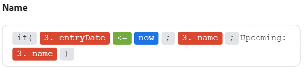
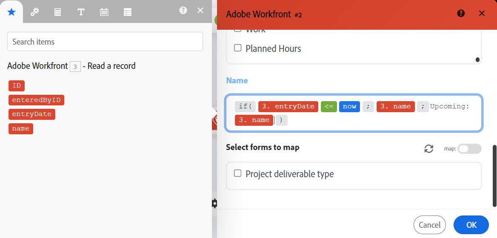
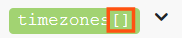

# Panoramica della mappatura

La mappatura è il processo di assegnazione degli output di un modulo ai campi di input di un altro modulo.

Il funzionamento di un modulo produce come output zero, uno o più bundle. Un bundle è costituito da uno o più elementi.

Puoi mappare questi elementi ai campi nei moduli successivi.

>[!NOTE]
>
>Workfront Fusion sta passando dall’editor dello scenario a una nuova esperienza. Durante questa transizione, sono disponibili sia le esperienze classiche che quelle nuove, e puoi passare da una all’altra in qualsiasi momento. È consigliabile utilizzare la nuova esperienza. Per ulteriori informazioni, consulta [Esperienze nuove e classiche](/help/workfront-fusion/get-started-with-fusion/navigate-fusion/scenario-editor.md#new-and-classic-experiences) nell&#39;articolo Editor scenari.

Quando fai clic su un campo in cui puoi inserire un valore generato da un modulo precedente in uno scenario, viene visualizzato il pannello di mappatura. Qui puoi selezionare l’elemento che desideri mappare. Una mappatura può includere uno o più dei seguenti elementi:

* Un singolo elemento
* Più elementi
* Testo statico
* Funzioni

>[!BEGINSHADEBOX]

**Esempi**:

Elemento singolo

Più elementi con testo

Funzione con più elementi e testo

>[!ENDSHADEBOX]

Per istruzioni sulla mappatura, consulta gli articoli in [Mappatura dati: indice degli articoli](/help/workfront-fusion/create-scenarios/map-data/map-data-toc.md).

>[!NOTE]
>
>Gli output dei moduli compresi tra un [!UICONTROL iteratore] e un [!UICONTROL aggregatore] non sono accessibili al di fuori del modulo [!UICONTROL aggregatore].

## Pannello di mappatura

Quando fai clic su un campo in cui puoi mappare i dati, viene aperto il pannello di mappatura.

Nella prima scheda vengono visualizzati gli elementi che è possibile mappare da altri moduli.

Le altre schede includono funzioni, operatori e parole chiave che puoi utilizzare per creare formule. Le formule vengono ordinate in schede diverse in base al tipo di dati che gestiscono.

Per ulteriori informazioni sulle schede delle funzioni, consulta [Panoramica delle funzioni](/help/workfront-fusion/get-started-with-fusion/understand-fusion/function-overview.md).

Per ulteriori informazioni sulla mappatura degli elementi tramite le funzioni, vedere [Mappare gli elementi utilizzando le funzioni incorporate](/help/workfront-fusion/create-scenarios/map-data/map-using-functions.md).

## Raccolte

Gli elementi possono contenere più valori di tipi diversi. Questi sono elementi di tipo raccolta.

I bundle di tipo raccolta mostrano `(Collection)` accanto all’etichetta del bundle nell’output del modulo.

Nella maggior parte dei casi vengono mappati gli elementi della raccolta anziché l’elemento che rappresenta l’intera raccolta.

Per individuare l’elemento di una raccolta nel pannello di mappatura, fai clic sulla freccia accanto alla raccolta.

Per ulteriori informazioni sulle raccolte, consulta [Tipi di dati degli elementi](/help/workfront-fusion/references/mapping-panel/data-types/item-data-types.md).

Per istruzioni sulla mappatura delle raccolte, consulta [Mappare un elemento](/help/workfront-fusion/create-scenarios/map-data/map-data-from-one-to-another.md#map-an-item) nell’articolo Mappare le informazioni da un modulo all’altro.

## Array

Gli elementi possono contenere più valori dello stesso tipo. Questi elementi sono di tipo array.

I bundle di tipo array mostrano `(Array)` accanto all’etichetta del bundle nell’output del modulo.

Nel pannello di mappatura, gli array vengono visualizzati con parentesi quadre. È possibile identificare un elemento di tipo array tramite le parentesi quadre alla fine dell&#39;etichetta dell&#39;elemento. Per individuare un elemento di array specifico nel pannello di mappatura, fate clic sulla freccia accanto all&#39;array.

Per informazioni e istruzioni sulla mappatura di array ed elementi di array, consulta [Mappare array ed elementi array](/help/workfront-fusion/create-scenarios/map-data/map-an-array.md).
