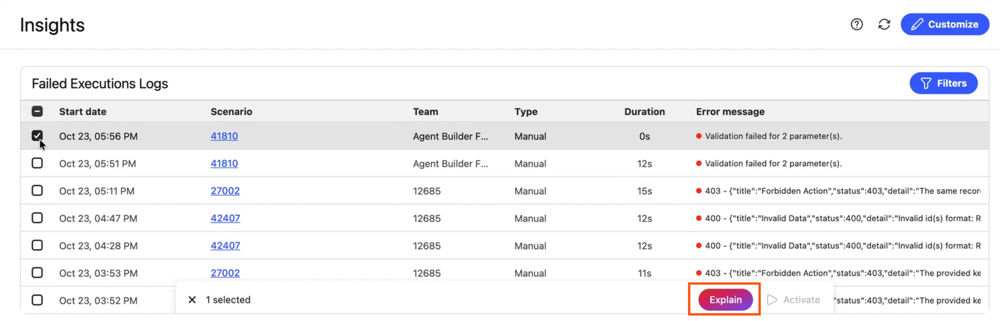

# Spiegare un errore di scenario con IA

Quando l’esecuzione di uno scenario non riesce, l’intelligenza artificiale può fornirti una breve descrizione in linguaggio semplice di ciò che è andato storto e di come correggerlo. La spiegazione viene visualizzata accanto all’errore originale, in modo da poterli leggere entrambi insieme.

È possibile spiegare gli errori nelle seguenti aree di Workfront Fusion:

* Dettagli dell’errore del modulo nel designer scenario
* Dettagli dell’esecuzione nella cronologia di esecuzione di uno scenario
* La tabella [!UICONTROL Log esecuzioni non riuscite] nella pagina Approfondimenti

>[!NOTE]
>
>Il pulsante **[!UICONTROL Spiega]** è disponibile solo nella nuova finestra di progettazione degli scenari. Non è disponibile nella finestra di progettazione dello scenario precedente.
>
>Per utilizzare questa funzione, la tua organizzazione deve disporre di una licenza di IA.

## Requisiti di accesso

+++ Espandi per visualizzare i requisiti di accesso per la funzionalità descritta in questo articolo.

<table style="table-layout:auto">
 <col> 
 <col> 
 <tbody> 
  <tr> 
   <td role="rowheader">Pacchetto Adobe Workfront</td> 
   <td> 
Qualsiasi pacchetto Workflow di Adobe Workfront, e qualsiasi pacchetto Automation and Integration di Adobe Workfront.

Workfront Ultimate

Pacchetti Workfront Prime e Select, con un ulteriore acquisto di Workfront Fusion.
 </td> 
  </tr> 
  <tr data-mc-conditions=""> 
   <td role="rowheader">Licenze Adobe Workfront</td> 
   <td> 
Standard

Work o successiva
 </td> 
  </tr> 
  <tr> 
   <td role="rowheader">Prodotto</td> 
   <td>
   
Se la tua organizzazione dispone di un pacchetto Workfront Select o Prime che non include Workfront Automation and Integration, dovrà acquistare Adobe Workfront Fusion.

   </td> 
  </tr>
 </tbody> 
</table>

Per ulteriori dettagli sulle informazioni contenute in questa tabella, consulta [Requisiti di accesso nella documentazione](/help/workfront-fusion/references/licenses-and-roles/access-level-requirements-in-documentation.md).

+++

## Spiegare un errore nei dettagli di output del modulo

1. Fai clic sulla scheda **[!UICONTROL Scenari]** nel pannello a sinistra.
1. Selezionare lo scenario in cui si desidera spiegare un errore.
1. Fai clic in un punto qualsiasi dello scenario per accedere all’editor scenario.
1. Eseguire lo scenario, come pianificato o facendo clic su **Esegui una volta**.
1. Quando un modulo non riesce, apri i relativi dettagli di errore.
1. Fai clic su **[!UICONTROL Spiega]**.

   Il pulsante si trova sotto l&#39;errore.

   

La spiegazione viene visualizzata sotto l&#39;errore.

>[!NOTE]
>
> * Durante la generazione della spiegazione da parte di IA, viene visualizzato uno stato di caricamento.
> * Se la spiegazione non viene generata, fare clic su **[!UICONTROL Riprova]**.
> * Se l’organizzazione raggiunge il limite di utilizzo di IA, viene visualizzato un messaggio di limite di utilizzo invece di una spiegazione.

## Spiegare un errore nella cronologia di esecuzione di uno scenario

1. Fai clic sulla scheda **[!UICONTROL Scenari]** nel pannello a sinistra, quindi fai clic sullo scenario.
1. Fare clic su **[!UICONTROL Cronologia]** accanto al nome dello scenario.
1. Fare clic sull&#39;esecuzione non riuscita da visualizzare.

   Ogni errore nei dettagli di esecuzione include un pulsante **[!UICONTROL Spiega]**.

1. Fai clic su **[!UICONTROL Spiega]** sotto l&#39;errore che desideri spiegare.

   Se nell’esecuzione di diversi moduli non è riuscito, puoi spiegare ogni errore singolarmente.

   

Per ulteriori informazioni sulla visualizzazione di un&#39;esecuzione, vedere [Visualizzare la cronologia dell&#39;esecuzione di uno scenario](/help/workfront-fusion/manage-scenarios/view-scenario-execution-history.md) e [Visualizzare l&#39;esecuzione di uno scenario specifico](/help/workfront-fusion/manage-scenarios/view-a-specific-scenario-execution.md).

>[!NOTE]
>
> * Durante la generazione della spiegazione da parte di IA, viene visualizzato uno stato di caricamento.
> * Se la spiegazione non viene generata, fare clic su **[!UICONTROL Riprova]**.
> * Se l’organizzazione raggiunge il limite di utilizzo di IA, viene visualizzato un messaggio di limite di utilizzo invece di una spiegazione.

## Spiegare un errore nella pagina Approfondimenti

1. In Fusion, fai clic su **[!UICONTROL Approfondimenti]** nell&#39;area di navigazione a sinistra.
1. Nella tabella [!UICONTROL Esecuzioni non riuscite], passa il cursore del mouse sulla riga non riuscita che desideri visualizzare.

   Viene visualizzato un pulsante **[!UICONTROL Spiega]**.

1. Fai clic su **[!UICONTROL Spiega]**.

   

   Viene visualizzata una finestra a comparsa che mostra l’errore e la spiegazione di IA.

Per ulteriori informazioni sulla pagina Approfondimenti, vedere [Visualizzare la dashboard Approfondimenti per un&#39;organizzazione](/help/workfront-fusion/set-up-and-manage-workfront-fusion/set-up-and-manage-orgs-and-teams/set-up-orgs-teams-and-users/view-insights-dashboard.md).

>[!NOTE]
>
> * Durante la generazione della spiegazione da parte di IA, viene visualizzato uno stato di caricamento.
> * Se la spiegazione non viene generata, fare clic su **[!UICONTROL Riprova]**.
> * Se l’organizzazione raggiunge il limite di utilizzo di IA, viene visualizzato un messaggio di limite di utilizzo invece di una spiegazione.
